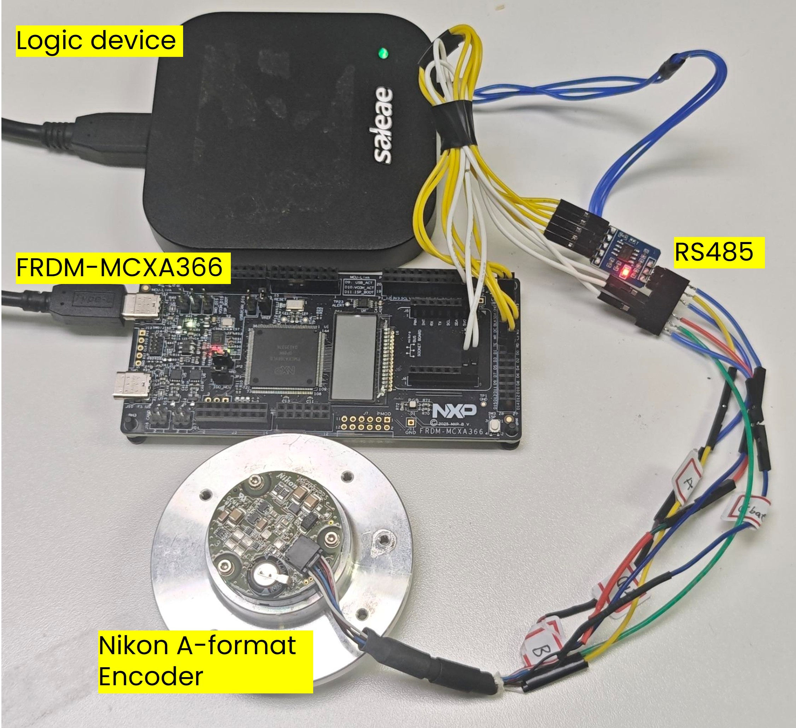
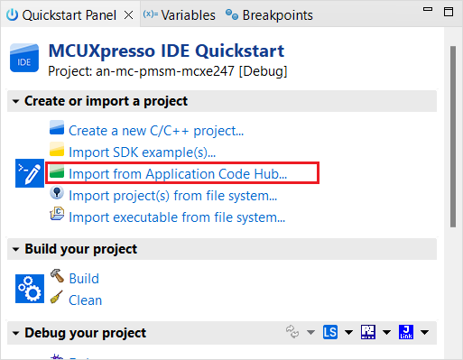
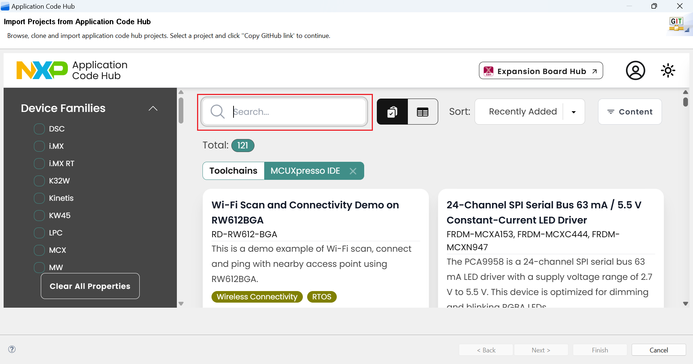
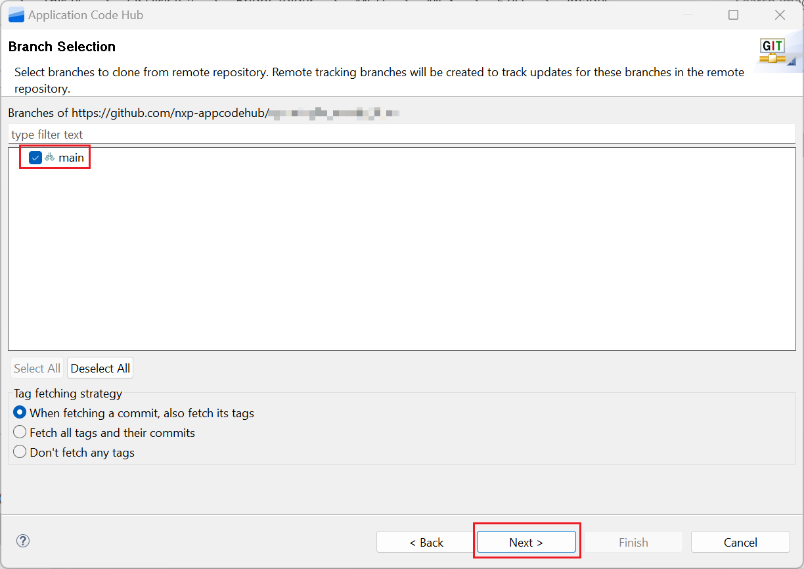

# NXP Application Code Hub

[](https://www.nxp.com)

## AN15179 Nikon A-format Interface Implemented by FlexIO on MCXA366

Note: A-format® is a registered trademark of the Nikon Corporation.

This software accompanies application note AN15179, which describes a FlexIO-based Nikon A-format master implemented on the FRDM-MCXA366. FlexIO emulates the half-duplex A-format serial interface: it drives the transmit data line, controls the direction pin of an external RS-485 transceiver, samples the encoder response, checks the command code and CRC of every frame, and decodes multi-turn position, single-turn position, encoder status (ES/ALM) and temperature.

### Key Features

- FlexIO implements the whole A-format master with 2 shifters and 3 timers: shifter 0 / timer 1 for TX, shifter 1 / timer 2 for RX, and timer 0 for the DR direction pin.
- Bit rate is 2.5 Mbps, which the 90 MHz FlexIO root clock used by this example divides down exactly. The driver also defines 4 / 6.67 / 8 / 16 Mbps, but those dividers only meet the baud-rate tolerance at other root clocks (48 MHz for 4 and 8 Mbps, 80 MHz for 6.67 Mbps), so selecting them at 90 MHz makes `FLEXIO_A_Format_Init()` return `kStatus_FLEXIO_A_FORMAT_BaudrateNotSupport`. The 16 Mbps path additionally needs 5 FlexIO timers, and FLEXIO0 on MCXA366 has 4.
- Data ID commands implemented: single-turn, multi-turn, single-turn + multi-turn, single-turn + status, single-turn + temperature, and encoder status readout.
- Control commands implemented: set/get encoder ID, set encoder address (1-to-1 and by matching ID), EEPROM read/write, and status clear with multi-turn reset (CDF 10).
- Every response is validated by command-code echo and CRC (CRC3 / CRC8); the parser reports per-encoder results through the ES field so a missing frame, a corrupted frame and an encoder-flagged fault are distinguishable.

#### Boards: FRDM-MCXA366

#### Categories: Motor Control

#### Peripherals: FlexIO

#### Toolchains: MCUXpresso IDE

## Table of Contents

1. [Software](#step1)
2. [Hardware](#step2)
3. [Setup](#step3)
4. [Results](#step4)
5. [Support](#step5)
6. [Release Notes](#step6)

## 1. Software<a name="step1"></a>

- [MCUXpresso IDE V25.6](https://www.nxp.com/design/design-center/software/development-software/mcuxpresso-software-and-tools-/mcuxpresso-integrated-development-environment-ide:MCUXpresso-IDE) or later
- [SDK_26_06_00_FRDM-MCXA366](https://mcuxpresso.nxp.com/)
- MCUXpresso for Visual Studio Code: This example supports MCUXpresso for Visual Studio Code, for more information about how to use Visual Studio Code please refer [here](https://www.nxp.com/design/design-center/training/TIP-GETTING-STARTED-WITH-MCUXPRESSO-FOR-VS-CODE).

## 2. Hardware<a name="step2"></a>

- FRDM-MCXA366
- Nikon A-format encoder (M50AHN00, 20-bit single-turn / 16-bit multi-turn)
- RS-485 transceiver module with a direction (driver-enable) input
- USB Type-C cable
- Personal Computer

## 3. Setup<a name="step3"></a>

### 3.1 Hardware Setup

1. Connect the A-format encoder to the FRDM-MCXA366 through the RS-485 transceiver according to the pin mapping table below. The table lists the MCXA366 side of the interface only: TX and RX are the transceiver logic-side data lines, which reach the encoder as one differential SD+/SD- pair. DR is a board-local transceiver direction control, not an encoder cable signal.
   
   | **Project<br> Signal** | **FlexIO<br> Signal** | **MCXA366<br> Pad** | **Direction** | **Purpose**                        |
   | ---------------------- | --------------------- | ------------------- | ------------- | ---------------------------------- |
   | DR                     | FLEXIO0_D16           | P2_8 (pin 41)       | Output        | RS-485<br> drive/receive control   |
   | TX                     | FLEXIO0_D17           | P2_9 (pin 42)       | Output        | Command data<br> to the encoder    |
   | RX                     | FLEXIO0_D18           | P2_10 (pin 43)      | Input         | Response data<br> from the encoder |
   | GND                    | -                     | GND                 | Reference     | Common<br> logic ground            |
   
   On the encoder side of the transceiver, wire 5.0V, GND, SD+ and SD- to the matching encoder pins.

2. Connect the FRDM-MCXA366 to the computer via a USB Type-C cable. The hardware setup is shown below:
   
   

### 3.2 Import Project

1. Open MCUXpresso IDE, in the Quick Start Panel, choose **Import from Application Code Hub**.<br>
   
   

2. Enter the demo name in the search bar.<br><br>
   
   

3. Click **Copy GitHub link**, MCUXpresso IDE will automatically retrieve project attributes, then click **Next>**.<br><br>
   
   

4. Select **main** branch and then click **Next>**, Select the MCUXpresso project, click **Finish** button to complete import.<br><br>
   
   

### 3.3 Demo hands-on

All demo options are collected at the bottom of `board/app.h`: encoder address, single-turn and multi-turn resolution, polling period, temperature refresh interval, and the Multiple Transmission test switch `DEMO_ENABLE_MT_TEST`.

1. Compile the project and download it to FRDM-MCXA366 board.
2. Open serial port assistant, set baud rate to 115200, 8 data bits, no parity, one stop bit, no flow control, and connect to the FRDM-MCXA366 debug UART port.
3. Press the reset button on FRDM-MCXA366 to begin operation. The demo runs the 16 test cases once and then keeps printing position and temperature.

The test cases are grouped as follows:

| **Test cases** | **Mode**                | **Content**                                                                                                             |
| -------------- | ----------------------- | ----------------------------------------------------------------------------------------------------------------------- |
| 1 - 3          | 1 to 1                  | Set encoder address, set encoder ID, get encoder ID                                                                     |
| 4 - 8          | Individual Transmission | Set address by matching ID, set/get ID, EEPROM write and read back                                                      |
| 9 - 15         | Individual Transmission | Status, temperature, multi-turn, single-turn, single-turn + status, single-turn + temperature, single-turn + multi-turn |
| 16             | Multiple Transmission   | One readout answered by several encoders (disabled by default)                                                          |

Before the readout tests the demo reads the alarm word (ALM) and waits for the encoder
to become ready. `ES=0x01` is the OR of two conditions that only ALM separates:
`ALM=0x0080` is Busy (the encoder is still determining the single-turn absolute
position, and it clears by itself with the shaft stopped or below 250 rpm), while
`ALM=0x0100` is MemBusy (EEPROM access in progress). The wait is bounded by
`DEMO_ENCODER_READY_TIMEOUT_US` and polled at `DEMO_ENCODER_READY_POLL_US`; on timeout
the demo keeps the multi-turn counter and continues with periodic ALM diagnostics.
CDF 10 is issued only once Busy and MemBusy are gone and ALM reports a fault it can
clear, because CDF 10 also resets the multi-turn counter. STErr, PSErr and IncErr need
a main-power cycle instead.

Address, ID and EEPROM writes are echo-verified and reported as acknowledged, followed
by the 30 ms memory-write settling time. An EEPROM read sends two identical requests at
least 300 us apart and publishes data only after the second response validates, ES
included; address F9h (temperature) is the one-request exception, and a failed read
leaves the previous value in place. Test case 8 compares the readback against `0x5A2B`.

## 4. Results<a name="step4"></a>

The serial assistant connected to the FRDM-MCXA366 serial port will display the result below. `ES` is the encoder status field, `ALM` the alarm word, multi-turn data is the sign-extended revolution count, and single-turn data spans 0 to 1048575 (2^20 - 1) with the default 20-bit profile.

```
Oct 10 2026 16:36:39
Encoder A-format example
FlexIO Root Clock is 90 MHz

******************** 1 to 1 mode (Only one encoder connects to the board) ********************
****************
* Test case  1 *
****************
> Set the encoder address to 3 ==> [encoder ES 0x01] acknowledged
****************
* Test case  2 *
****************
> Set the encoder ID to 0x030201 ==> [encoder ES 0x01] acknowledged
****************
* Test case  3 *
****************
> Get the encoder ID ==> 0x030201 (successful)

******************** Individual Transmission mode (The board accesses only one encoder on the bus) ********************
****************
* Test case  4 *
****************
> The encoder address 3 is set by matching the ID 0x030201 ==> [encoder ES 0x01] acknowledged
****************
* Test case  5 *
****************
> Set the encoder ID to 0x030201 ==> [encoder ES 0x01] acknowledged
****************
* Test case  6 *
****************
> Get the encoder ID ==> 0x030201 (successful)
****************
* Test case  7 *
****************
> Write the data 0x5A2B to the address 0x01 of EEPROM ==> [encoder ES 0x01] acknowledged
****************
* Test case  8 *
****************
> Read the data from the address 0x01 of EEPROM ==> 0x5A2B (readback verified)

******************** Preparing the encoder ********************
> Read the status of the encoder 0x03 ==> ES: 0x00, ALM: 0x0000
        ALM: no alarm bit is set
> No CDF10-clearable ALM fault is set, the multi-turn counter is kept as is
****************
* Test case  9 *
****************
> Read the status of the encoder 0x03 ==> ES: 0x00, ALM: 0x0000 (status received)
        ALM: no alarm bit is set
****************
* Test case 10 *
****************
> Get the temperature of the encoder ==> 41.000000 (successful)
****************
* Test case 11 *
****************
> Get the multi-turn data of the encoder ==> ES: 0x00, Multi-turn: 0 (successful)
****************
* Test case 12 *
****************
> Get the single-turn data of the encoder ==> ES: 0x00, Single-turn: 924823 (successful)
****************
* Test case 13 *
****************
> Get the single-turn data and status of the encoder ==> ES: 0x00, Single-turn: 924823, status: 0x0000 (successful)
****************
* Test case 14 *
****************
> Get the single-turn data and temperature of the encoder ==> ES: 0x00, Single-turn: 924823, temperature: 41.000000 (successful)
****************
* Test case 15 *
****************
> Get the single-turn data and the multi-turn data of the encoder ==> successful
        Multi-turn data: 0, single-turn data: 924823

******************** Multiple Transmission mode (The board can access multiple encoders on the bus simultaneously) ********************
****************
* Test case 16 *
****************
> Skipped: needs 4 encoders on the bus (see DEMO_ENABLE_MT_TEST)

******************** Running the loop test ********************
[2.110s] Multi-turn data: 0, single-turn data: 920043
        Temperature: 41.000000

[2.242s] Multi-turn data: 0, single-turn data: 946985
        Temperature: 41.000000
```

## 5. Support<a name="step5"></a>

#### Project Metadata

<!----- Boards ----->

[](https://www.nxp.com/pip/FRDM-MCXA366)

<!----- Categories ----->

[](https://mcuxpresso.nxp.com/appcodehub?category=motor_control)

<!----- Peripherals ----->

[](https://mcuxpresso.nxp.com/appcodehub?peripheral=flexio)

<!----- Toolchains ----->

[](https://mcuxpresso.nxp.com/appcodehub?toolchain=mcux)

Questions regarding the content/correctness of this example can be entered as Issues within this GitHub repository.

> **Note**: For more general technical questions regarding NXP Microcontrollers and the difference in expected functionality, enter your questions on the [NXP Community Forum](https://community.nxp.com/)

[](https://www.youtube.com/NXP_Semiconductors)
[](https://www.linkedin.com/company/nxp-semiconductors)
[](https://www.facebook.com/nxpsemi/)
[](https://x.com/NXP)

## 6. Release Notes<a name="step6"></a>

| Version | Description / Update                    | Date                           |
|:-------:| --------------------------------------- | ------------------------------:|
| 1.0     | Initial release on Application Code Hub | October 22<sup>nd</sup> 2026 |
